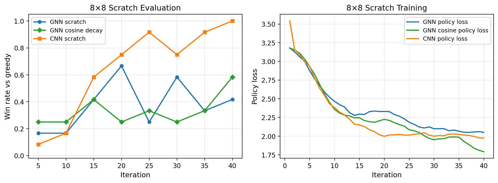

# AlphaGateau for Breakthrough

Does a board-size-invariant graph encoder help AlphaZero-style self-play? This repository adapts
the AlphaGateau idea from chess to the abstract strategy game **Breakthrough** and tests it
against a CNN, on 8×8 play and on 5×5 → 8×8 transfer. It contains the JAX environment, both
models, the self-play training pipeline, the transfer experiments, automated figure generation,
and the paper and presentation.

McGill COMP 579 team project (three authors, listed in the paper).
**Paper:** [report/paper.pdf](report/paper.pdf) · **Write-up:**
[athmanebenarous.com/work/alphagateau-breakthrough](https://athmanebenarous.com/work/alphagateau-breakthrough)

## Results

All win rates are against a greedy evaluator over 12 games, so treat exact percentages as rough.

- **From scratch on 8×8, the CNN wins.** It reaches a 100% win rate by iteration 40; the GNN
  plateaus near 42%.
- **5×5 pretraining helps the GNN early.** Its 8×8 win rate at iteration 5 goes from 17% to 67%,
  but pretraining doesn't close the long-run gap.
- **Head to head,** the CNN beats the best GNN 7 games to 5.



## Quick start

**No Slurm? Any Linux GPU or notebook works:**

```bash
git clone https://github.com/Otm02/alphagateau-breakthrough-v2
cd alphagateau-breakthrough-v2
pip install -e ".[cuda12]"        # or cuda13, or just . for CPU
python scripts/show_runtime_info.py
python scripts/run_smoke_suite.py  # 1-iter sanity check, writes figures
```

**On McGill mimi with the shared team environment:**

```bash
bash scripts/mimi_collect_outputs.sh   # pull existing results
bash scripts/mimi_full_dag.sh          # submit the full pipeline
```

See [RUN_GUIDE.md](RUN_GUIDE.md) for all three supported paths (standalone GPU, personal Slurm
env, shared team Slurm env).

## Repository layout

```
src/alphagateau_breakthrough/   Core library (env, graph, models, training, eval, plotting)
scripts/                        Training CLIs + Slurm submission + mimi wrappers
slurm/                          sbatch job templates
tests/                          Unit tests
notebooks/                      Self-contained demo notebook
artifacts/                      Per-run configs, metrics and evaluations; head-to-head results
report/                         Paper source, PDF and figures
presentation/                   Slides
```

## Key design notes

- **Action encoding**: `from_square × 3 + move_type` where `move_type ∈ {forward, diag_left,
  diag_right}` in the current player's canonical perspective.
- **Board-size invariance**: the GNN uses the same node and edge feature schema on 5×5 and 8×8,
  enabling direct cross-board transfer without any parameter shape changes.
- **Resume support**: training writes `latest_resume.pkl` at every checkpoint, capturing model
  params, optimizer state, replay buffer, RNG state, and accumulated metrics. Any run can be
  resumed after an interruption or cluster timeout.
- **Slurm**: the sbatch templates do not hardcode account or QoS. Pass `--account` / `--qos` to
  `submit_mimi_pipeline.py`, or set `SLURM_ACCOUNT` / `SLURM_QOS` when using the mimi wrappers.
